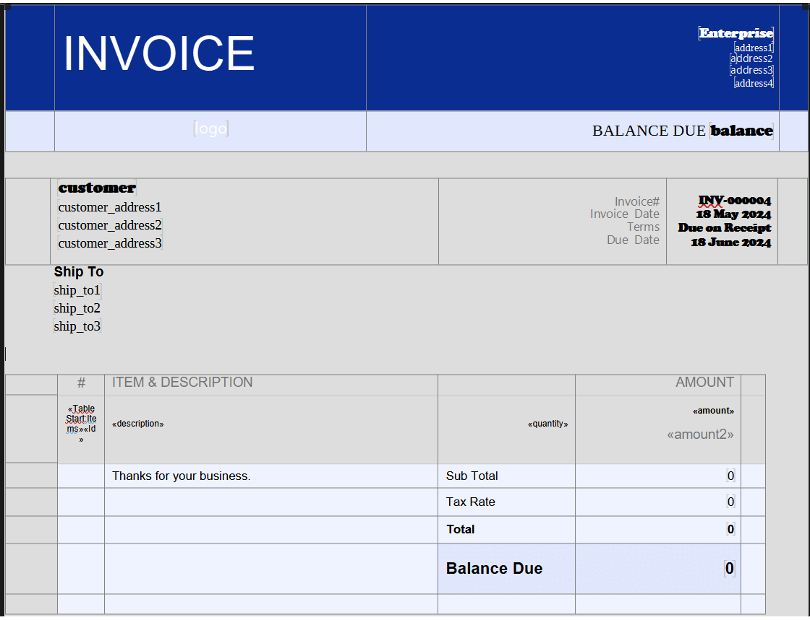

# FodtToPdf

.NET libraries for reading OpenDocument Flat XML templates (`.fodt`), filling them with data, and exporting the result to PDF. The repository contains both the core template/conversion library and an optional QuestPDF-based PDF renderer.



The animation shows the original invoice template and the generated result.

## Projects

| Project | Description |
|---|---|
| `FodtToPdf` | Core library: loads `.fodt` templates, replaces bookmarks and repeating regions, inserts images, supports master/detail documents, and converts to PDF through LibreOffice. |
| `FodtToPdf.QuestPdf` | Optional renderer that draws the extracted template model with QuestPDF and SkiaSharp, without invoking LibreOffice. |
| `samples/InvoiceSample` | Fills `invoice-template.fodt` with sample invoice data and writes both QuestPDF and LibreOffice PDFs. |
| `samples/DailySalesReportSample` | Fills `daily-sales-report.fodt` with sample daily-sales data and writes both PDF variants. |
| `samples/RegionalSalesReportSample` | Builds a grouped master/detail report with 12 regions, cloning a detail template and appending it to the master document. |

## Main features

- Template loading from a file or a byte array.
- Bookmark replacement for scalar values.
- Repeating table regions backed by `DataTable`.
- Master/detail reports through `Clone()` and `AppendDoc()`.
- Image insertion at bookmarks, with explicit width and height.
- Paragraph, table, cell, border, header, and footer support.
- Table width handling based on the declared ODF table and column widths.
- Font substitution for commonly missing fonts, including `Open Sans` and `Aptos`.
- Two PDF backends:
  - QuestPDF (no LibreOffice process required).
  - LibreOffice headless (fallback and reference output).

## Requirements

- .NET 10 SDK.
- LibreOffice installed for the LibreOffice conversion path.
- Windows system fonts for the default renderer configuration. Missing fonts are substituted using the rules in `FodtToPdf.QuestPdf`.

NuGet dependencies for the QuestPDF renderer are declared in `FodtToPdf.QuestPdf.csproj`.

## Basic usage

```csharp
using FodtToPdf;

var template = FodtTemplate.Load("invoice-template.fodt");

template.SetBookmarkIfExists("customer", "Acme Distribution LLC");
template.SetBookmarkIfExists("total", "$3,661.88");

var items = new DataTable("Items");
items.Columns.Add("description");
items.Columns.Add("amount");
items.Rows.Add("Consulting", "$1,250.00");

template.ExecuteRegion("Items", items);

var filledFodt = template.ToBytes();
var pdf = QuestPdfFodtRenderer.Render(filledFodt);

File.WriteAllBytes("invoice.pdf", pdf);
```

For LibreOffice output:

```csharp
var pdf = QuestPdfFodtRenderer.RenderWithLibreOffice(filledFodt);
```

## Build

Build the core library and the QuestPDF renderer:

```bash
dotnet build FodtToPdf/FodtToPdf.csproj
dotnet build FodtToPdf.QuestPdf/FodtToPdf.QuestPdf.csproj
```

## Samples

Run any sample from its project directory:

```bash
cd samples/InvoiceSample
dotnet run
```

Each sample creates a filled `.fodt` and two PDFs, one for each backend:

```text
<sample>-questpdf.pdf
<sample>-libreoffice.pdf
```

## License

This project is licensed under the MIT License. See [LICENSE](LICENSE).
